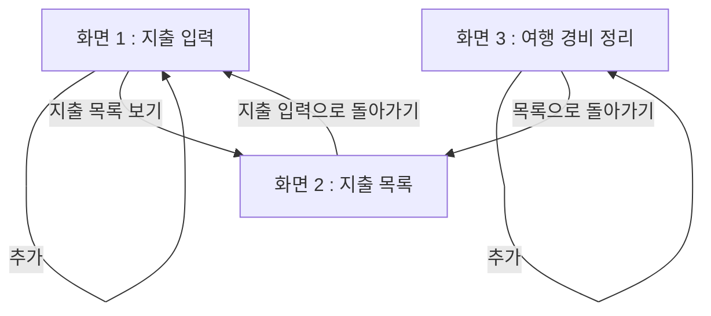

# PRD — 지출 입력
- 상태 : 완성
- 한 줄 정의 : 여행모임 총무가 팀원 카드로 낸 지출을 표시하면, 그 사람에게 돌려줄 금액이 자동으로 나와서 손으로 계산하지 않아도 된다

## 1. 문제
### 배경
여행모임 총무는 여행 전 숙소·교통편 예약비 정산부터 여행 중 공동으로 드는 경비까지, 지출이 생길 때마다 정산을 맡는다.
지금은 영수증을 손으로 모아두었다가 나중에 계산기로 계산하거나 카드 사용내역을 보고 손수 계산하고, 단톡방에 사용내역을 올려 각자 얼마씩 총무 계좌로 보내라고 알린다.
이 과정에서 영수증을 매번 챙기다 잃어버리기도 하고, 어떤 카드를 썼는지 헷갈리며, 특히 총무 카드가 아닌 다른 팀원의 카드로 지출했을 때는 나중에 정산 계산이 복잡해진다.

### 목표
총무가 지출을 입력할 때마다 낸 사람(카드)을 표시하면, 팀원 카드로 낸 지출에 대해 그 사람에게 돌려줄 금액이 자동으로 계산되어 나오게 해서, 총무가 따로 시간을 내어 손으로 계산하지 않아도 되게 한다.

## 2. 사용자
### 페르소나
- 누구인가 : 여행모임의 총무
- 언제 겪는 문제인가 : 여행 전 숙소예약·교통편예약 등의 비용정산부터, 여행 중 공동으로 드는 경비가 생길 때마다
- 왜 불편한가 : 영수증을 매번 챙기는데 잃어버리기도 하고, 어떤 카드를 썼는지 헷갈리며, 총무 카드가 아닌 다른 팀원 카드로 지출했을 때 나중에 정산 계산이 복잡해짐
- 지금은 어떻게 하는가 : 영수증을 손으로 모아두었다가 나중에 계산기로 계산하거나 카드 사용내역을 보고 손수 계산함. 그리고 단톡방에 사용내역을 올려 각자 얼마씩 총무 계좌로 보내라고 알림

### 사용자 스토리
- 총무로서, 지출마다 날짜·항목·금액·낸 사람(카드)을 입력하고 싶다. 나중에 계산기로 다시 계산하지 않아도 한 곳에 모아두고 싶기 때문이다.
- 총무로서, 여행 전 예약 비용과 여행 중 경비를 같은 화면에 함께 입력하고 싶다. 여행 시작부터 끝까지 지출을 한 번에 몰아보고 싶기 때문이다.
- 총무로서, 총무 카드가 아닌 팀원 카드로 낸 지출을 표시하고 싶다. 그 사람에게 돌려줄 금액을 손으로 계산하지 않고 자동으로 받고 싶기 때문이다.

## 3. 범위
### 넣을 기능
1. 지출을 쓸 때마다 날짜·항목·금액·낸 사람(카드)을 입력하면, 나중에 계산기로 다시 계산할 필요 없이 한 곳에 모인다.
2. 여행 전 예약 비용과 여행 중 경비를 같은 화면에 같이 입력하면, 여행 시작부터 끝까지 지출을 한 번에 몰아볼 수 있다.
3. 총무 카드가 아닌 다른 팀원 카드로 낸 지출을 표시하면, 그 사람에게 따로 돌려줄 금액이 자동으로 계산된다. (핵심)

### 기능 요구사항
1. 지출 입력 화면에서 날짜·항목·금액·낸 사람(카드)을 넣고 "추가"를 누르면, 지출 목록 표에 한 줄로 추가된다.
2. 지출을 입력할 때 "구분"(예약/현장)을 표시해 넣으면, 여행 전 예약 비용과 여행 중 경비가 같은 표 안에 함께 쌓여 처음부터 끝까지 몰아볼 수 있다.
3. 낸 사람(카드) 칸에 총무가 아닌 팀원을 표시해 넣으면, 그 지출 줄의 "돌려줄 금액" 칸에 그 팀원에게 돌려줄 금액이 자동으로 나온다.
   - 등록된 팀원 목록에 없는 이름을 낸 사람으로 넣으면, "등록된 팀원 중에 없는 이름이에요. 목록에서 골라주세요"라는 안내와 함께 팀원 목록을 다시 보여준다.
   - "돌려줄 금액"은 그 지출 줄에 입력한 금액을 그대로 돌려주는 방식으로 계산한다. (인당 몫은 총무 계좌로 따로 보내는 것이라, 이 금액과 서로 빼는 계산은 하지 않는다.)

### 비목표
- 지출마다 어떤 카드로 냈는지 골라서 표시하는 기능 — 넣을 기능 3(팀원 카드로 낸 지출 표시)에 "누가/어느 카드로 냈는지"를 최소한으로 기록하는 부분이 이미 포함되어 있어, 따로 만들지 않아도 넣을 기능을 쓰는 데 지장이 없다.
- 계좌번호를 한 번 등록해두면 다음부터 메시지에 그대로 들어가는 기능 — 넣을 기능 1~3을 만들고 써보는 데 지장이 없어 이번 범위에서 뺀다.
- 입력된 지출을 모두 더해 총 금액과 한 사람이 낼 금액을 자동으로 계산해주는 기능 — 넣을 기능 1~3을 쓰는 데는 지장이 없지만, 총무가 전체 정산에서 한 사람당 낼 총액을 보려 할 때 이 기능이 없어 막히는 지점으로 확인되었다. 나중에 붙일 기능으로 남긴다.
- 계산이 끝나면 단톡방에 바로 올릴 수 있는 "얼마씩 입금해주세요" 메시지를 만들어주는 기능 — 넣을 기능 1~3을 쓰는 데는 지장이 없지만, 총무가 결과를 단톡방에 알리려 할 때 이 기능이 없어 직접 옮겨 적어야 하는 막히는 지점으로 확인되었다. 나중에 붙일 기능으로 남긴다.
- 영수증 사진을 찍어 올리면 금액을 자동으로 읽어 입력해주는 기능 — 넣을 기능 1~3을 만들고 써보는 데 지장이 없어 이번 범위에서 뺀다.

## 4. 화면
### 사용자 흐름
- 화면 1 : 지출 입력 — 날짜·항목·금액·낸 사람(카드)을 입력해 지출을 추가한다.
- 화면 2 : 지출 목록 — 입력된 지출을 표로 모아보고, 표의 "돌려줄 금액" 칸에서 팀원에게 돌려줄 금액을 확인하며, 지출 입력 화면으로 다시 돌아갈 수 있다.
- 화면 3 : 여행 경비 정리 — 구분(예약/현장)을 표시해 여행 전 예약 비용과 여행 중 경비를 같은 표에 몰아보고, 표의 "돌려줄 금액" 칸에서 팀원에게 돌려줄 금액을 확인하며, 지출 목록 화면으로 돌아갈 수 있다.

## 5. 완성 기준
### 수용 기준
- 지출 하나마다 날짜·항목·금액·낸 사람(카드)을 입력해 "추가"를 누르면, 지출 목록 표에 한 줄로 나타난다.
- 화면 3(여행 경비 정리)에서 구분(예약/현장)을 표시해 지출을 추가하면, 표의 구분 칸에 "예약" 또는 "현장"이라는 값이 나타난다.
- 총무 카드가 아닌 팀원 카드로 낸 지출에 낸 사람을 표시하면, 그 줄의 "돌려줄 금액" 칸에 그 팀원에게 돌려줄 금액이 자동으로 나온다.
- 등록된 팀원 목록에 없는 이름을 낸 사람으로 입력하면, "등록된 팀원 중에 없는 이름이에요. 목록에서 골라주세요" 안내와 함께 팀원 목록을 다시 보여준다.
- 낸 사람(카드) 칸에 총무가 아닌 팀원을 표시해 지출을 추가하면, 그 줄의 "돌려줄 금액" 칸에는 입력한 금액과 같은 값이 나오고, 낸 사람이 총무이면 "돌려줄 금액" 칸은 비어 있거나 0으로 나온다.

